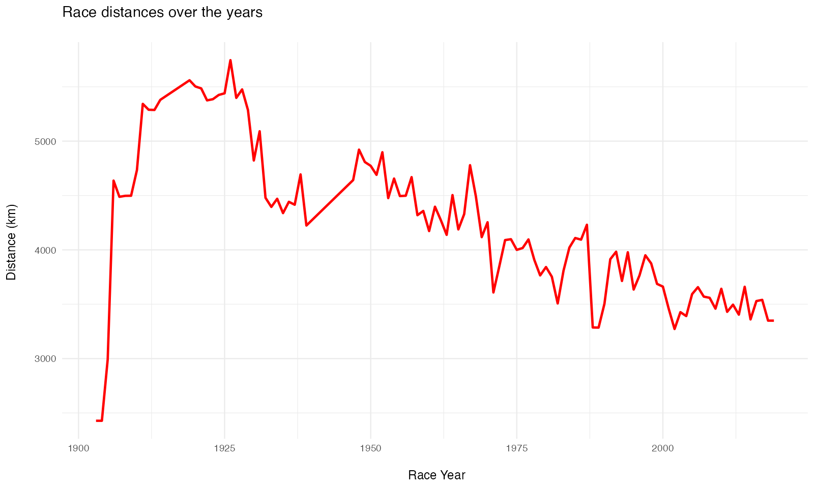
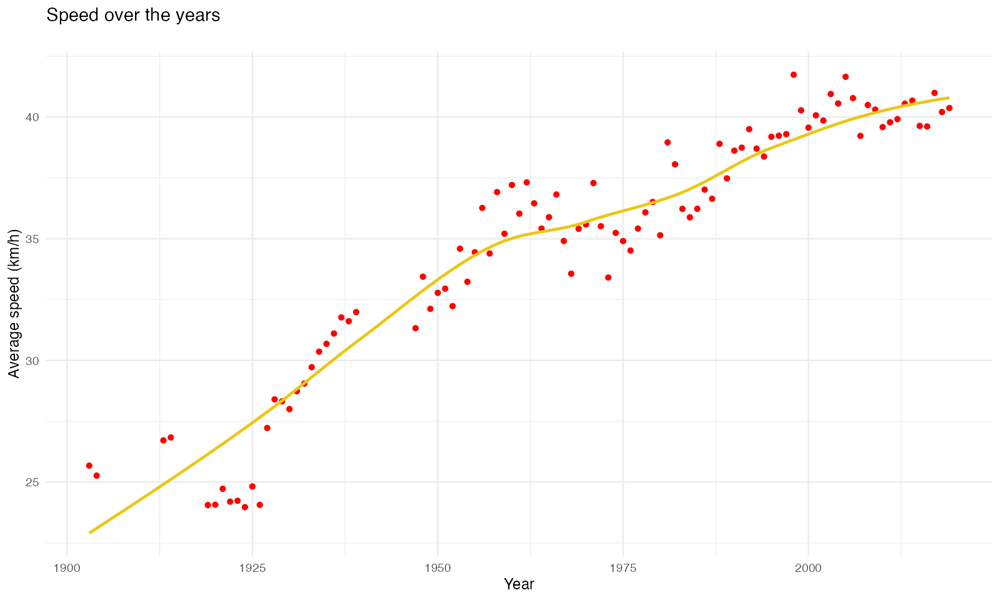
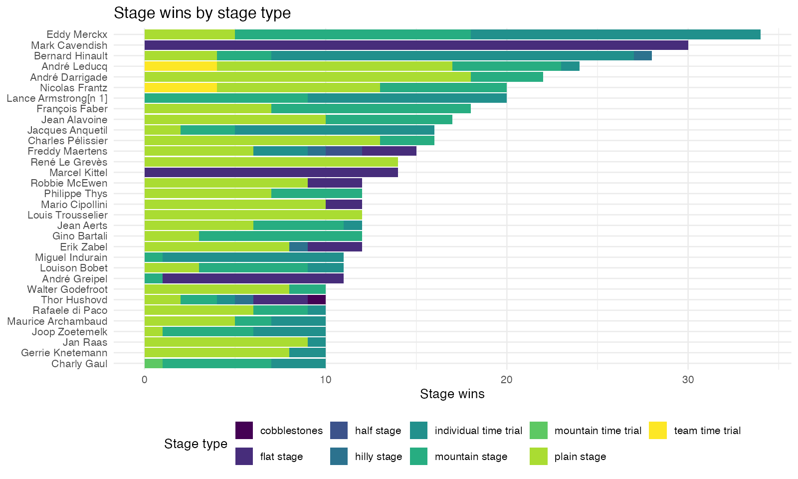

# A ride through Tour de France data
### Exploring the race, one chart at a time.

  

If you know me, you know I'm a cycling fan. This project follows that curiosity through the Tour's history: race distances, riders, teams, stage types and the places the race visits.

**[Read the analysis source →](analysis.Rmd)** · [Download the HTML walkthrough](analysis.html) · [Explore the data](data)



## Three ways into the analysis

| The race | The riders | The route |
|---|---|---|
| How have distance and average speed changed? | Which names recur in the historical winners data? | Where do stages start and finish? |
| [Distance](images/p4.png) · [Speed](images/p6.png) | [Riders](images/p1.png) · [Teams](images/p2.png) | [Start locations](images/p9.png) · [Stage types](images/p11.png) |

<table>
<tr>
<td width="50%"><br><strong>A changing race</strong><br>Average speed across editions in the source.</td>
<td width="50%"><br><strong>Different ways to win</strong><br>Actual stage wins by type, rather than repeated rider totals.</td>
</tr>
</table>

## Run the walkthrough

Open `tour_de_france.Rproj`, then install the packages used in the notebook:

```r
install.packages(c("tidyverse", "lubridate", "viridis", "ragg", "rmarkdown"))
rmarkdown::render("analysis.Rmd", output_format = "html_document")
```

Run from the project folder. Pandoc is required for HTML rendering and is included with RStudio. The notebook reads the bundled CSV files and regenerates the chart images, so no live data service is needed. The 2026 refresh was rerun with R 4.4.1.

## Data and interpretation

This uses the [7 April 2020 TidyTuesday dataset](https://github.com/rfordatascience/tidytuesday/tree/main/data/2020/2020-04-07).

| File | Rows | Coverage |
|---|---:|---|
| `tdf_winners.csv` | 106 | Editions from 1903–2019 |
| `tdf_stages.csv` | 2,236 | Stages from 1903–2017 |
| `tdf_stage_wins.csv` | 255,752 | Detailed rider stage-result rows |

The files cover different periods. The third file's name is historical: its rows include detailed rider results, not just stage winners. The source also retains annulled Tour results, including Lance Armstrong's; it should not be read as the current official roll of honour.

Stage-win and general-classification-lead totals drawn from `tdf_winners` describe **Tour-winning editions**, not every rider's whole career. Leading the general classification is different from leading a breakaway. Comparisons across eras also reflect changes in routes, rules and equipment.

<details>
<summary><strong>Full chart gallery</strong></summary>

[Riders](images/p1.png) · [Teams](images/p2.png) · [Nationalities](images/p3.png) · [Distances](images/p4.png) · [Times](images/p5.png) · [Speeds](images/p6.png) · [Stage wins in winning editions](images/p7.png) · [GC stages led](images/p8.png) · [Stage starts](images/p9.png) · [Stage finishes](images/p10.png) · [Stage types](images/p11.png) · [Distance by stage type](images/p12.png) · [Wins by stage type](images/p13.png)

</details>

Made by [Steph Boyle](https://stephanieboyle.github.io/) · Cycling · R · Data storytelling
